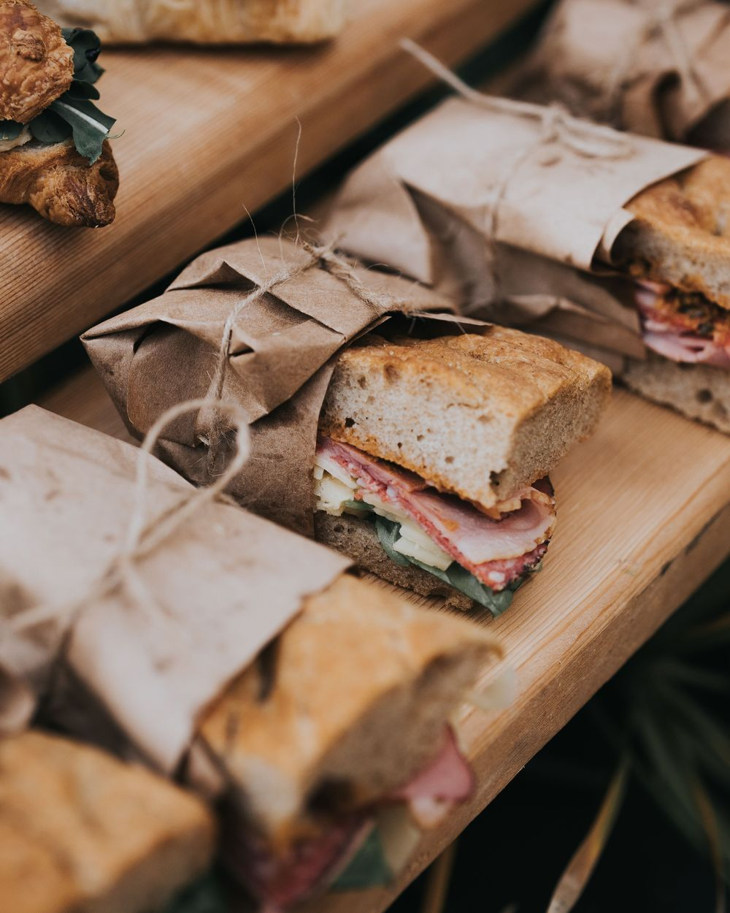

There's a good range of places to eat and drink, day or night, within minutes of the front door. These are the ones we keep going back to.

## On your *doorstep*

**Adriano's Deli** for an Italian-inspired salad or sandwich.

**Café Beam** for a feel-good lunch or a casual coffee.

**Baby Grey Gosforth**, Lauren's pick for coffee.

**Basilico** for neighbourhood pizza and pasta.

## For an *evening*

**The Brandling Arms** for good pub food and a quality selection of beers, and David's pick for a relaxed pint.

**Say When** wine bar for a glass of something special.

## A little further: *Jesmond*

The neighbouring suburb of Jesmond has lively bars and plenty of choice. Osborne Road alone has more than ten bars; **Dabbawal** serves modern Indian street food, and **LOCAL** does great coffee, matcha and snacks.

## And of course, *Greggs*

It started life just a few miles away, and there are more than 100 across the city. Try a pease pudding stottie, the local favourite.
