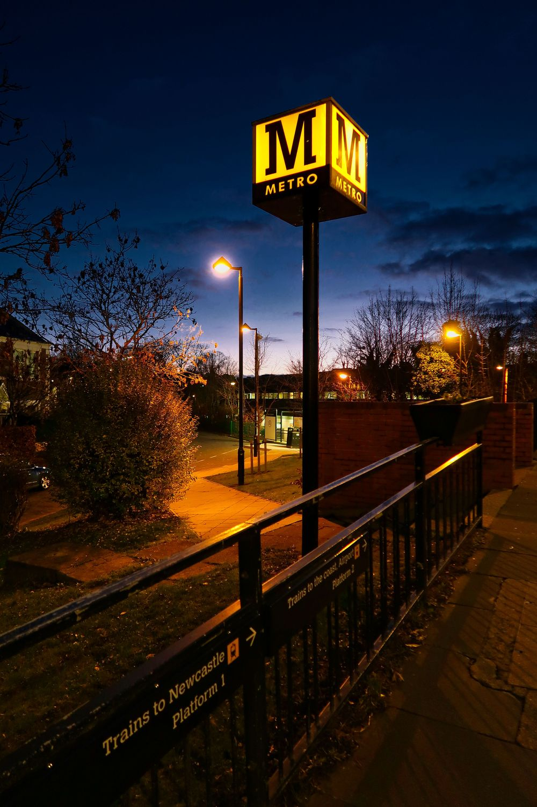

You'll often find that walking or public transport is just as quick as driving from Winter's Nook. Here's how we get about.

## The *Metro*

Regent Centre Metro station is about ten minutes' walk from the front door, and from there it's around ten minutes to central Newcastle. Every Metro line can be reached from here, and the coast at Tynemouth is about 25 minutes away.

## Buses

Over 20 bus routes stop within ten minutes' walk. The closest stops are on Gosforth High Street, and many faster buses leave from Regent Centre.

## On *foot*

Gosforth High Street is about fifteen minutes' walk, the city centre around forty, and Jesmond Dene, a tranquil riverside walk, about twenty.

## Parking

The flat is on a car-free street. With a council guest permit you can park on nearby streets marked Zone G3; ask us at least 5 days before you arrive. Without a permit, try Gosforth Library (Hedley Terrace) or Salters Road Car Park.
